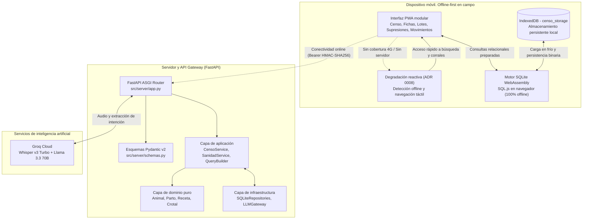

# Ganaderos. PWA offline-first para gestión ganadera en extensivo

Aplicación web progresiva (PWA) para gestión operativa de vacuno de carne en pastos y dehesas. Funciona sin cobertura móvil ejecutando SQLite en el navegador mediante WebAssembly (SQL.js) con persistencia en IndexedDB. Incluye backend asíncrono con FastAPI y un asistente por voz basado en llamadas a herramientas estructuradas (intent calling), con degradación cuando no hay conexión.



---

## Decisiones clave de arquitectura e ingeniería

### 1. Clean architecture (puertos y adaptadores)
El sistema separa las reglas de negocio de los mecanismos de persistencia e interfaz:
- `src/domain/`: reglas de negocio sin dependencias externas. Contiene objetos de valor inmutables (`Crotal`, `PeriodoSupresion`, `ExplotacionCEA`), interfaces de repositorio (`repositories.py`) y entidades (`Animal`, `Parto`, `RecetaSanitaria`, `Movimiento`, `CompraAlimento`).
- `src/application/`: casos de uso y orquestación (`services.py` con `CensoService`, `SanidadService`, `GenealogiaService`), catálogo tipado de intenciones (`intents.py`) y constructor de consultas SQL parametrizadas (`query_builder.py`).
- `src/infrastructure/`: implementaciones SQLite de repositorios (`repositories.py`), pasarela de llamadas a herramientas con modelos de lenguaje (`llm_gateway.py`) y capa anticorrupción para bases de datos Access heredadas (`access_reader.py`).
- `src/server/`: servidor asíncrono FastAPI con validación Pydantic v2, gestión de ciclo de vida con `lifespan`, documentación OpenAPI en `/docs`, proxy de audio Whisper y traducción de excepciones de dominio (`DomainError` a HTTP 422).

### 2. Intent calling tipado frente a text-to-sql libre
En lugar de permitir que un modelo de lenguaje genere sentencias SQL arbitrarias, el sistema utiliza extracción estructurada de intenciones:
1. El modelo extrae la intención y los parámetros (por ejemplo, `intent: "consultar_partos_madre"`, `crotal_4: "1045"`).
2. `QueryBuilder` traduce la intención a una sentencia SQL preparada con parámetros ligados (`?`), verificada mediante tests unitarios.
3. La consulta resultante se ejecuta en el navegador sobre la base de datos WebAssembly. Los datos ganaderos no se envían a servicios externos de IA.

### 3. Degradación en modo desconectado (ADR 0008)
En zonas de campo sin cobertura móvil:
- Las funciones operativas (censo ganadero, búsqueda por cuatro dígitos de crotal, genealogía de madres y crías, lotes de pasto, periodos de supresión sanitaria y libro de movimientos) funcionan localmente en SQLite WebAssembly.
- Si se abre el asistente por voz sin conexión, la interfaz detecta el estado desconectado, desactiva la grabación de audio y muestra accesos directos al buscador táctil y al censo por lotes.
- Se prescinde de analizadores heurísticos locales por expresiones regulares (ADR 0008), manteniendo la lógica de consulta determinista en la base de datos local.

### 4. Registros de decisiones de arquitectura (ADR)
Las decisiones técnicas del proyecto están documentadas bajo el estándar MADR en `docs/adr/`:
- [ADR 0001: motor relacional local-first con SQLite WASM e IndexedDB](docs/adr/0001-local-first-sqlite-wasm-indexeddb.md)
- [ADR 0002: intent calling tipado frente a text-to-sql libre](docs/adr/0002-typed-intent-calling-vs-raw-text-to-sql.md)
- [ADR 0003: arquitectura limpia hexagonal y servidor FastAPI](docs/adr/0003-hexagonal-clean-architecture-python-fastapi.md)
- [ADR 0004: resiliencia offline y estrategia de caché del Service Worker](docs/adr/0004-offline-resilience-and-pwa-caching-strategy.md)
- [ADR 0005: descomposición modular del frontend en ES modules](docs/adr/0005-es-modules-frontend-decomposition.md)
- [ADR 0006: despliegue en servidores edge y convivencia con sistemas heredados](docs/adr/0006-edge-deployment-and-coexistence.md)
- [ADR 0007: marco de evaluación y pruebas de intenciones para IA](docs/adr/0007-ai-intent-benchmarking-and-eval-framework.md)
- [ADR 0008: degradación reactiva y retirada de analizadores heurísticos locales](docs/adr/0008-graceful-degradation-and-heuristic-removal.md)

---

## Estructura del repositorio

```text
ganaderos/
├── .github/
│   └── workflows/
│       └── ci.yml                  # Integración continua: Ruff, tests Python, tests Node.js, Docker
├── docs/
│   └── adr/                        # Registros de decisiones de arquitectura (MADR)
│       ├── 0001-local-first-sqlite-wasm-indexeddb.md
│       ├── 0002-typed-intent-calling-vs-raw-text-to-sql.md
│       ├── 0003-hexagonal-clean-architecture-python-fastapi.md
│       ├── 0004-offline-resilience-and-pwa-caching-strategy.md
│       └── 0005-es-modules-frontend-decomposition.md
├── pwa/                            # Cliente web offline-first (ES Modules)
│   ├── css/
│   │   └── app.css                 # Hojas de estilo y temas
│   ├── js/
│   │   ├── modules/                # Módulos JavaScript
│   │   │   ├── api.js              # Cliente HTTP para la API FastAPI
│   │   │   ├── auth.js             # Gestión de sesión y autenticación
│   │   │   ├── config.js           # Estado global y utilidades
│   │   │   ├── db.js               # Adaptador SQLite WASM e IndexedDB
│   │   │   ├── voice.js            # Grabación de audio y Web Speech API
│   │   │   └── views/              # Vistas de la aplicación
│   │   │       ├── assistant_view.js # Interfaz del asistente
│   │   │       ├── cattle_view.js    # Censo y búsqueda por crotal
│   │   │       ├── detail_view.js    # Ficha individual, genealogía y lotes
│   │   │       ├── feeds_view.js     # Gestión de compras de piensos
│   │   │       ├── movements_view.js # Libro de movimientos
│   │   │       └── sanitary_view.js  # Recetas y periodos de supresión
│   │   ├── app.js                  # Inicialización y enrutamiento
│   │   ├── db_client.js            # Abstracción sobre la base de datos local
│   │   ├── sql-wasm.js             # Cargador de WebAssembly
│   │   └── sql-wasm.wasm           # Binario SQLite compilado a WASM
│   ├── favicon.ico
│   ├── icon-192.png
│   ├── icon-512.png
│   ├── icon.svg
│   ├── index.html                  # Punto de entrada HTML
│   ├── manifest.json               # Manifiesto de instalación PWA
│   └── sw.js                       # Service Worker y gestión de caché
├── src/
│   ├── domain/                     # Capa de dominio (entidades y reglas puras)
│   │   ├── exceptions.py           # Excepciones de negocio
│   │   ├── models.py               # Entidades del modelo ganadero
│   │   ├── repositories.py         # Interfaces de repositorios
│   │   └── value_objects.py        # Objetos de valor inmutables
│   ├── application/                # Capa de aplicación (casos de uso)
│   │   ├── intents.py              # Definición tipada de intenciones
│   │   ├── query_builder.py        # Generador de consultas SQL parametrizadas
│   │   └── services.py             # Servicios de censo, sanidad y genealogía
│   ├── infrastructure/             # Capa de infraestructura (adaptadores)
│   │   ├── access_reader.py        # Lector de bases de datos Access heredadas
│   │   ├── llm_gateway.py          # Adaptador para modelos de lenguaje
│   │   ├── repositories.py         # Repositorios implementados sobre SQLite
│   │   └── sqlite_builder.py       # Inicialización del esquema relacional
│   └── server/                     # Servidor HTTP y API
│       ├── app.py                  # Aplicación FastAPI y ciclo de vida
│       └── schemas.py              # Esquemas de entrada y salida con Pydantic
├── scripts/
│   ├── generate_demo_db.py         # Generación de base de datos de demostración
│   └── run_server.py               # Arranque del servidor local
├── tests/                          # Batería de pruebas
│   ├── frontend/
│   │   └── test_modules.mjs        # Pruebas de módulos frontend en Node.js
│   ├── unit/
│   │   ├── test_application_services.py # Pruebas unitarias de servicios
│   │   ├── test_domain.py          # Pruebas de entidades y objetos de valor
│   │   ├── test_domain_repositories.py  # Pruebas de repositorios SQLite
│   │   └── test_intents.py         # Pruebas de catálogo de intenciones
│   └── integration/
│       ├── test_api_fastapi.py     # Pruebas de integración de la API
│       └── test_demo_db.py         # Pruebas de consistencia de datos de prueba
├── compose.yaml                    # Configuración de Docker Compose
├── Dockerfile                      # Imagen de contenedor para despliegue
├── pyproject.toml                  # Configuración de dependencias y herramientas
└── README.md
```

---

## Pila tecnológica

| Capa | Tecnologías | Propósito |
| :--- | :--- | :--- |
| Frontend PWA | ES Modules nativos, CSS3, HTML5 | Interfaz sin dependencias de frameworks para uso táctil en campo. |
| Almacenamiento local | SQL.js (SQLite WebAssembly), IndexedDB | Consultas relacionales directas en el dispositivo móvil sin conexión. |
| Backend y API | Python 3.12, FastAPI, Pydantic v2, Uvicorn | Endpoints tipados, validación de esquemas y documentación OpenAPI. |
| Transcripción e IA | Groq Whisper Large v3, Llama 3.3 70B | Transcripción de audio y extracción de parámetros de consulta. |
| Contenedores y CI | Docker, GitHub Actions | Validación de estilo, ejecución de tests y empaquetado. |

---

## Inicio rápido

### Despliegue con Docker Compose (recomendado)

```bash
git clone https://github.com/Alvaro137/ganaderos.git
cd ganaderos
docker compose up -d
```

Abrir en el navegador: `http://localhost:8000` (clave de acceso por defecto: `mvp-testing`).

Documentación interactiva de la API: `http://localhost:8000/docs`.

---

### Ejecución local en desarrollo

1. Requisitos: Python 3.10+ y Node.js 18+.

2. Instalar dependencias:
   ```bash
   pip install -e .
   ```

3. Generar la base de datos de demostración con razas autóctonas (Morucha, Limusina, Charolesa):
   ```bash
   python scripts/generate_demo_db.py --animales 150
   ```

4. Iniciar el servidor local:
   ```bash
   python scripts/run_server.py
   ```

5. Abrir `http://localhost:8000` en el navegador.

---

## Control de calidad y pruebas automatizadas

Comandos para ejecutar las comprobaciones de estilo y pruebas automatizadas:

```bash
# 1. Comprobación de estilo y linter
ruff check .

# 2. Pruebas de frontend en Node.js
node tests/frontend/test_modules.mjs

# 3. Pruebas unitarias y de integración en Python
python -m unittest discover tests
```

---

## Seguridad y privacidad de datos

- Los datos ganaderos no se transmiten al modelo de lenguaje en la nube. El modelo solo procesa la orden de voz o texto para devolver la intención y sus argumentos. La consulta SQL se ejecuta en el navegador.
- Las consultas generadas por `QueryBuilder` usan siempre parámetros ligados (`?`), evitando la concatenación directa de cadenas en sentencias SQL.
- Las excepciones de negocio (`CrotalInvalidoError`, `ExplotacionInvalidaError`) se devuelven al cliente con código HTTP 422.
- El repositorio no incluye datos reales de explotaciones. Las pruebas utilizan el generador sintético de `scripts/generate_demo_db.py`.

---

## Licencia

Este proyecto se distribuye bajo la licencia MIT. Consulta el archivo `LICENSE` para más información.


